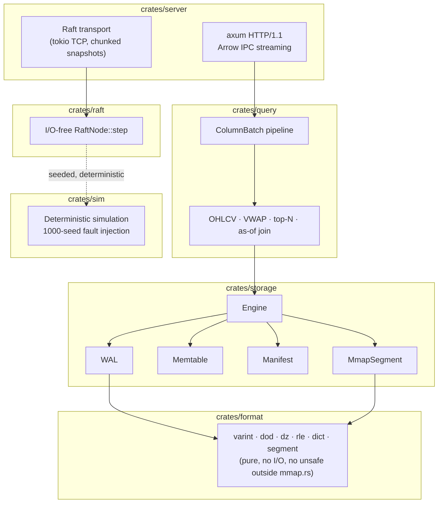

# tickdb

A from-scratch distributed columnar tick-data storage engine in Rust:
custom binary segment format, a vectorized query layer, and Raft
replication built and verified by a deterministic simulation harness —
built as a systems-engineering portfolio project, not for production quant
use.

## What's here

- **Custom storage format** (`crates/format`): delta-of-delta timestamp
  encoding, delta+zigzag price encoding, RLE for aggressor side, zstd
  block compression. ~6.5 bytes/trade on synthetic data (~20% smaller than
  Zstd-compressed Parquet on the same data — see `docs/BENCHMARKS.md`).
- **Storage engine** (`crates/storage`): WAL + memtable + manifest +
  mmap'd segments, with a proven crash-recovery argument and size-tiered
  compaction.
- **Query engine** (`crates/query`): OHLCV resample, VWAP, top-N, and a
  two-pointer as-of join — every kernel checked against a naive reference
  implementation across 50 seeds in differential tests.
- **Raft consensus** (`crates/raft`, `crates/sim`): an I/O-free
  `RaftNode::step` state machine, log compaction with leader-installed
  snapshots, and a deterministic simulation harness that ran **1,000
  seeds of full fault injection (drop/delay/duplicate/partition/crash)
  with zero invariant violations**.
- **HTTP + real TCP transport** (`crates/server`): axum HTTP API with
  Arrow IPC streaming responses, and a real multi-node Raft transport
  (chunked snapshot transfer, TCP framing) verified against a genuine
  3-process cluster on localhost — not just the simulator.

## Architecture



**Dependency rule**: `format ← storage ← query ← server`. `raft` and `sim`
depend on neither `storage` nor `query` — they only exchange `Vec<u8>` log
payloads, which is what keeps the consensus core testable in complete
isolation from the storage engine it eventually drives.

## Quick start

```bash
# build everything
cargo build --workspace --release

# single-node: ingest a CSV and run the HTTP server
cargo run -p cli --release -- ingest --data-dir ./data --symbol BTCUSDT --csv trades.csv
cargo run -p server --release -- --data-dir ./data --port 8080

# multi-node (Raft): see docker-compose.yml, or run 3 processes directly —
# docs/DESIGN.md's Phase 3 section has the full command lines.
```

## Testing this yourself

```bash
cargo test --workspace
cargo test -p sim --test campaign chaos_campaign_1000_seeds --release  # ~3 min
./bench/chaos_demo.sh   # needs docker
```

See `docs/DESIGN.md` for the full design rationale (why delta-of-delta,
why the WAL fsync policy is structured the way it is, the crash-recovery
correctness argument, the Raft safety-property proofs) and
`docs/BENCHMARKS.md` for benchmark methodology, results, and an honest
accounting of where the implementation falls short of its original
throughput targets.

## What this project is (and isn't) trying to demonstrate

This is a systems-engineering portfolio piece: the goal was to build
something with real depth in storage formats, crash recovery, query
vectorization, and distributed consensus — not to out-perform DuckDB or
compete with a production time-series database. `docs/BENCHMARKS.md` is
explicit about where tickdb wins (compactness only — roughly 20% smaller
than Zstd-compressed Parquet), where a mature vectorized engine like
DuckDB clearly wins (every benchmarked query shape, including the
hand-tuned OHLCV kernel, by margins ranging from ~1.5x to ~22x
depending on the query), and where the implementation misses its own
originally-stated targets (OHLCV throughput by roughly 6.3-6.6x). As-of
join throughput was never benchmarked against DuckDB, so no comparison
is claimed either way — reported as measured, not adjusted to flatter
the result.
